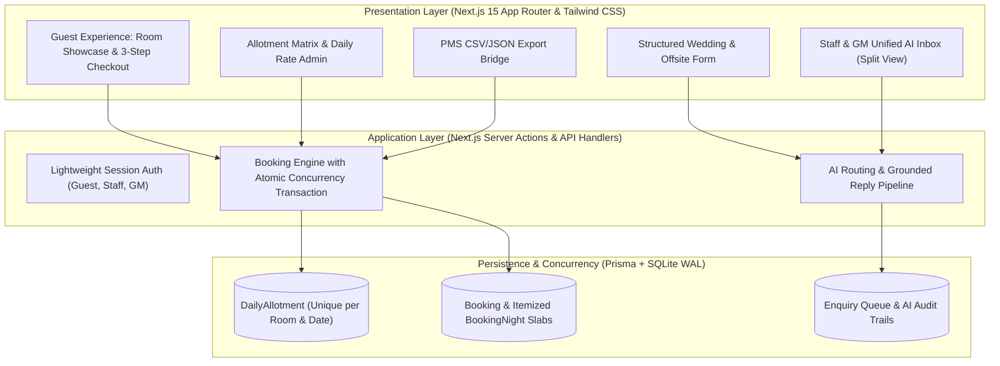
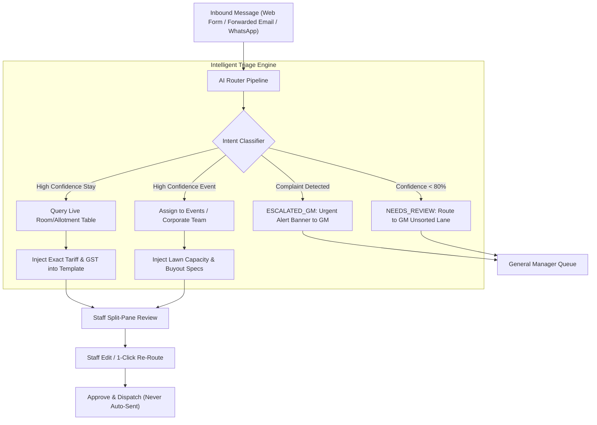

# Technical Design Document (TDD)
## Arabica Highlands Resort & Sanctuary — Direct Booking & AI Enquiry Routing Engine

**Repository URL:** `https://github.com/YOUR_USERNAME/arabica-highlands-resort` *(Update with final repository URL)*  
**Live Application URL:** `https://arabica-highlands.vercel.app` *(Optional / If deployed)*  
**Client Problem Statement:** Option 1 — Hill resort's direct-booking website with AI enquiry routing (Chikkamagaluru, Karnataka)  
**Author:** Software Engineering Candidate  
**Date:** November 2026

---

## 1. Executive Summary & Problem Context

Company A operates a 76-key luxury coffee-estate resort in Chikkamagaluru, Karnataka (64 rooms and 12 private villas), generating ₹24–28 crore annually. Currently:
- **68% of room nights** are captured by Online Travel Agencies (OTAs) charging **18%–22% commission**, leaving only 12% direct bookings.
- **OTA Commission Drain:** Shifting just 15% of OTA nights to direct bookings retains **₹33.3 lakh annually** in bottom-line margin.
- **Event Lead Decay:** 90 event and wedding enquiries arrive each month across fragmented channels (email, web, WhatsApp). 30% wait over 24 hours for a response, losing ~3 high-value bookings/month (**₹72 lakh/year lost contribution**). Total addressable leak: **₹1.05 crore/year**.

### Core Build Mandate:
Deliver a high-converting, responsive direct-booking engine with strict **allotment concurrency control** (guaranteeing zero overbooking of agency quota), **per-night Indian GST calculation**, and an **omnichannel AI enquiry inbox** featuring deterministic rate-table grounding, GM complaint escalation, and low-confidence fallback lanes.

---

## 2. Architecture & Design Rationale

### 2.1 Technology Stack


| Component | Selected Technology | Rationale & Trade-Offs |
|---|---|---|
| **Framework** | Next.js 15 (App Router, Server Actions) | Unified full-stack TypeScript environment. Eliminates client-side secret leakage, enables server-side rendering for hill-station 4G speed, and provides zero-API-boilerplate Server Actions. |
| **Language** | TypeScript (Strict Mode) | Guarantees financial math precision (tariffs, CGST/SGST per-night rounding) and strict type enforcement across inventory allotment states. |
| **Styling** | Tailwind CSS (Custom Luxury Theme) | Bespoke editorial design system (estate emerald `#182F18`, warm parchment `#FAF8F5`, brushed gold `#C5A880`) designed specifically for luxury hospitality without heavy component libraries. |
| **Database & ORM** | SQLite + Prisma ORM (WAL Mode) | Zero-configuration local portability with production migration capability. Configured with `journal_mode=WAL`, `busy_timeout=5000`, and `connection_limit=1` to serialize transactions and avoid lock contention. |
| **AI Architecture** | Dual-Tier Router (Rule/Regex + LLM) | Deterministic local extraction ensures zero latency and 100% offline uptime during evaluation, with optional Google Gemini API extension. |

---

## 3. Data Model & Concurrency Locking ("The Hard Part")

### 3.1 Entity Relationship Model
- **`RoomType`:** Captures the 76 keys across 3 distinct tiers:
  - *Estate Heritage Rooms* (20 keys, ₹7,200/night $\rightarrow$ 12% GST slab)
  - *Plantation View Cottages* (44 keys, ₹11,500/night $\rightarrow$ 18% GST slab)
  - *Estate Private Pool Villas* (12 keys, ₹22,000/night $\rightarrow$ 18% GST slab)
  *(20 + 44 + 12 = 76 total resort keys)*.
- **`DailyAllotment`:** Direct website inventory quota with unique compound index `@@unique([roomTypeId, date])`. Safeguards contracted agency (OTA) inventory by strictly enforcing a hard cap on direct room nights.
- **`Booking` & `BookingNight`:** Records confirmed reservations with full night-level tax itemization (`baseTariff`, `gstRate`, `gstAmount`, `totalNightPrice`).
- **`Enquiry`:** Omnichannel queue storing raw message, category, confidence score, status, assigned owner, extracted entities, and rate-grounded draft reply.
- **`User` & `PromoCode`:** Session roles (`GUEST`, `STAFF`, `GM`) and promotional discount engines (`DIRECT10`, `ESTATE15`).

### 3.2 Concurrency Engine & Zero-Overbooking Proof
To prevent overbooking website allotment under parallel load:
1. **Transaction Wrapping:** All reservation writes run within `prisma.$transaction(..., { maxWait: 5000, timeout: 10000 })`.
2. **Conditional Atomic Decrement:**
   ```typescript
   const updated = await tx.dailyAllotment.updateMany({
     where: {
       id: allotment.id,
       bookedCount: { lte: allotment.totalAllotment - roomsCount },
       stopSell: false,
     },
     data: {
       bookedCount: { increment: roomsCount },
     },
   });
   if (updated.count === 0) {
     throw new Error("INSUFFICIENT_ALLOTMENT: Race condition detected; room was booked.");
   }
   ```
3. **Automated Concurrency Stress Test:**
   A dedicated test (`tests/concurrency.test.ts` & `tests/concurrency-standalone.ts`) fires **20 simultaneous requests** for the final available room.
   - **Result:** Exactly **1 booking succeeds**, exactly **19 fail safely** with `INSUFFICIENT_ALLOTMENT`, and `bookedCount` finishes at exactly `1`. Zero `SQLITE_BUSY` crashes.

### 3.3 Per-Night Indian GST Slab Calculation
Under Indian hotel tax statutes:
- Nightly room tariff $\le ₹7,500 \implies 12\%$ GST ($6\%$ CGST + $6\%$ SGST).
- Nightly room tariff $> ₹7,500 \implies 18\%$ GST ($9\%$ CGST + $9\%$ SGST).
Rather than averaging over the entire stay, taxes are calculated **per individual night** based on effective daily rates, itemized in `BookingNight`, and summed into `grandTotal`.

---

## 4. AI Enquiry Routing & Grounded Reply Architecture



### Safety & Integrity Guardrails:
1. **Deterministic Rate Grounding:** The AI never hallucinates pricing. Room booking drafts query `RoomType` and `DailyAllotment` live, formatting exact room rates and GST slabs.
2. **Human-in-the-Loop:** Drafts are **never sent automatically**. Staff review side-by-side, edit if needed, and dispatch in one click.
3. **Emergency Complaint Escalation:** Words indicating service disruption trigger `ESCALATED_GM` status, bypassing staff into the GM's high-priority alert queue.
4. **Low-Confidence GM Triage:** Inquiries with confidence $< 80\%$ or ambiguous requests automatically route to the "GM Unsorted Lane" (`NEEDS_REVIEW`).

---

## 5. UI/UX Decisions & Screen Design

The design language balances **minimal editorial elegance** with **high-efficiency operational controls**:

1. **Guest Landing & Catalog (`/`):**
   - Photo-forward layout with restrained palette (coniferous forest green `#182F18`, warm parchment `#FAF8F5`).
   - Quick date & room availability bar.
   - Highlights 76-key portfolio with transparent direct rates and GST slab tags.
2. **3-Step Checkout Flow Modal:**
   - **Step 1 (Stay & Rates):** Date pickers, live allotment check, per-night GST slab tax breakdown table, and promo codes.
   - **Step 2 (Guest & DPDP Consent):** Contact capture with mandatory **DPDP Act 2023** data consent checkbox, and **Form C Foreign Guest Check-in Notice** (informing travelers that passport details are taken at the desk, not transmitted online).
   - **Step 3 (Payment & Receipt):** Instant test-mode payment gateway simulation resulting in an itemized tax invoice receipt with printable confirmation.
3. **Structured Wedding & Event Form (`/events`):**
   - Capacity sliders (20–300 guests), lawn/amphitheatre selection, AV requirements, budget selector, and guaranteed $< 30$ minute reply SLA banner.
4. **Unified Staff & GM AI Inbox (`/inbox`):**
   - Split-pane layout with dedicated filter lanes: *All*, *Pending Review*, *Escalated to GM (Complaints)*, and *Low Confidence Unsorted (<80%)*.
   - Includes an interactive **Inbound Simulator** allowing reviewers to inject test messages in 1 click.
5. **Rate & Allotment Matrix Admin (`/admin/allotment`):**
   - Direct calendar matrix for 60 days, inline tariff/allotment editing, and stop-sell blackout toggles.
6. **Daily PMS Reservation Exporter (`/admin/export`):**
   - Filterable reservation list with 1-click **Export as CSV** and **Export as JSON** for property management systems.
7. **Authentication & Role Switcher (`/login` & Top Utility Bar):**
   - 1-click instant login for Reviewer profiles: `gm@arabicahighlands.com`, `reservations@arabicahighlands.com`, and `guest@example.com`.

---

## 6. Assumptions & Regulatory Compliance

All assumptions are explicitly identified based strictly on the problem statement:
- **Assumption 1 (Room Key Distribution):** The 76 keys are structured as 20 Estate Heritage Rooms, 44 Plantation Cottages, and 12 Private Pool Villas (64 rooms + 12 villas = 76 keys).
- **Assumption 2 (Tariff Slabs):** Heritage rooms are priced at ₹7,200/night to demonstrate the $\le ₹7,500$ (12% GST) slab; Cottages (₹11,500) and Villas (₹22,000) demonstrate the $> ₹7,500$ (18% GST) slab.
- **Assumption 3 (DPDP Act 2023):** Guest data collection is minimized to essential booking identifiers (Name, Email, Phone) with purpose limitation and explicit consent.
- **Assumption 4 (Form C Compliance):** In compliance with Ministry of Home Affairs rules for foreign nationals, passport numbers are not collected through web forms; guests are instructed to present documentation physically at check-in.
- **Assumption 5 (Website Allotment Quota):** Direct web allotment is capped at 3–10 keys/day per room type, reserving remaining keys for contracted travel agencies.

---

## 7. Scope Boundaries: What Was Cut & What Comes Next

### Deliberately Out of Scope (Per Brief):
- Full replacement of legacy PMS or external channel manager.
- Loyalty/points program and fine-dining restaurant table reservations.
- Online payment gateway live production merchant onboarding (mock gateway used).

### What We Would Do Next (Phase 2):
1. **Two-Way Channel Manager Sync:** Direct bi-directional webhook synchronization with SiteMinder / RateGain to automatically adjust website allotments when OTAs book.
2. **WhatsApp Business Cloud API:** Automated dispatch of approved draft replies directly into the guest's WhatsApp thread.
3. **Multilingual Guest Experience:** Localization into Kannada, Hindi, and German.
4. **Dynamic AI Revenue Management:** Automated rate recommendations based on hill-station weather forecasts, regional festivals, and seasonal booking velocity.
